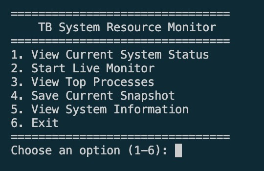

# TB System Resource Monitor

## What the application does

Python command-line app that shows CPU, memory, and disk usage. 

## Features

- View current CPU, memory, and main-disk usage.
- Display used and total memory and disk space in GB.
- Warn when CPU or memory usage exceeds 80%, or disk usage exceeds 90%.
- Refresh a live display.
- Show five processes using the most memory.


## Technologies

- Python 3
- `psutil` for system resource and process information
- modules: `os`, `platform`, `socket`, `time`, `csv`, and `datetime`

## Project structure

```text
system-resource-monitor/
├── main.py           # Menu, user input, and connections between features
├── monitor.py        # System information, measurements, warnings, and processes
├── logger.py         # Timestamped CSV snapshot logging
├── logs/
│   ├── .gitkeep      # Keeps the log folder in Git
│   └── snapshots.csv # Generated when saving; ignored by Git
├── screenshots/
│   └── menu.png      # Screenshot of the running menu
├── .gitignore        # Excludes caches, environments, scratch tests, and CSV logs
├── requirements.txt  # Third-party dependency: psutil
└── README.md         # Project description and usage instructions
```

## Installation

```bash
git clone https://github.com/fbertil/system-resource-monitor.git
cd system-resource-monitor
python3 -m pip install -r requirements.txt
```

## How to run

From the project folder, run:

```bash
python3 main.py
```

Choose an option from 1 to 6. Press Enter after viewing a result to return to the menu. During live monitoring, press Ctrl+C to stop and return to the menu prompt.

## Menu options

| Option | Action |
|---|---|
| 1. View Current System Status | Collect CPU, memory, and disk measurements and display any warnings. |
| 2. Start Live Monitor | Repeatedly display resource percentages and their OK or HIGH statuses. |
| 3. View Top Processes | Display the five readable processes using the most memory, largest first. |
| 4. Save Current Snapshot | Append a timestamp and the CPU, memory, and disk percentages to the CSV log. |
| 5. View System Information | Show the operating system, computer name, processor, and Python version. |
| 6. Exit | Print a goodbye message and close the program. |

## Screenshots / demo



## Known limitations

- Measuring CPU usage takes about one second. The live monitor then waits two seconds, so updates appear about every three seconds.
- Processes that end or cannot be read with the current user's permissions are skipped.
- Memory usage in GB and the reported percentage may appear inconsistent on macOS because of how memory is accounted for.

## Optional features I added

None yet.

## What I learned

This project gave me practice writing functions that return dictionaries and lists. I worked with loops, conditionals, exception handling, and table formatting while connecting the system measurements to a menu. I also practiced appending CSV rows, building paths relative to a module, and using Git commits and pushes to save progress.
